# Architecture diagrams

The diagrams are UML 2, drawn in PlantUML 1.2026.8. Their sources are in the game repository
under [`docs/architecture`](https://github.com/goose-meat-eng1/goose-patrol/tree/main/docs/architecture).
Class, operation and state names are the names in the Java code, and requirement IDs are those of
our Requirements document (Req1).

## Current diagrams (v0.4.0)

| Report figure | Diagram | Kind of UML diagram |
| --- | --- | --- |
| Figure 1 | [D1 component overview](#d1-component-overview) | Component diagram |
| Figure 2 | [D2 model classes](#d2-model-classes) | Class diagram |
| Figure 3 | [D3 run states](#d3-run-states) | State machine diagram |
| Figure 4 | [D3 goose and Goose Man states](#d3-goose-and-goose-man-states) | State machine diagram |
| Figure 5 | [D4 one frame of play](#d4-one-frame-of-play) | Sequence diagram |
| Figure 6 (website only) | [D5 using an item](#d5-using-an-item) | Sequence diagram |

### D1 component overview

[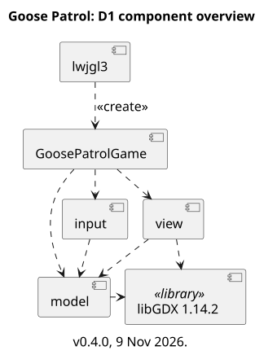](diagrams/v0.4.0/out/d1-component-overview.svg)

### D2 model classes

[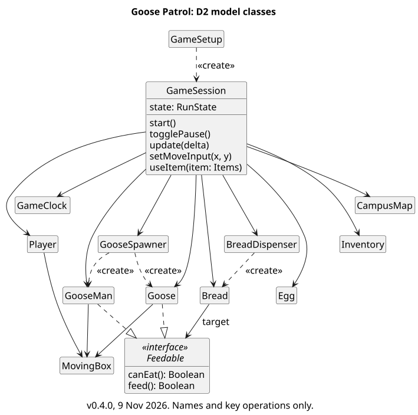](diagrams/v0.4.0/out/d2-model-classes.svg)

### D3 run states

[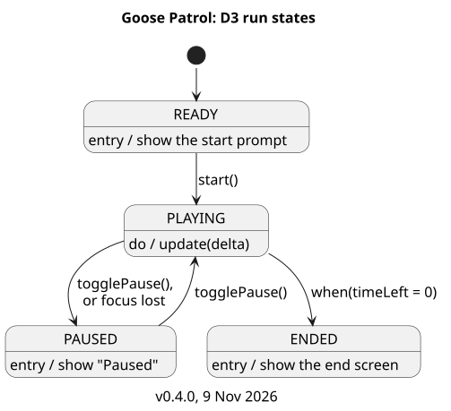](diagrams/v0.4.0/out/d3-run-states.svg)

### D3 goose and Goose Man states

[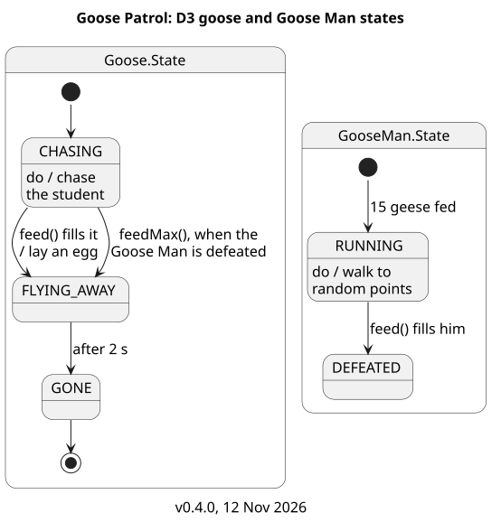](diagrams/v0.4.0/out/d3-goose-states.svg)

### D4 one frame of play

[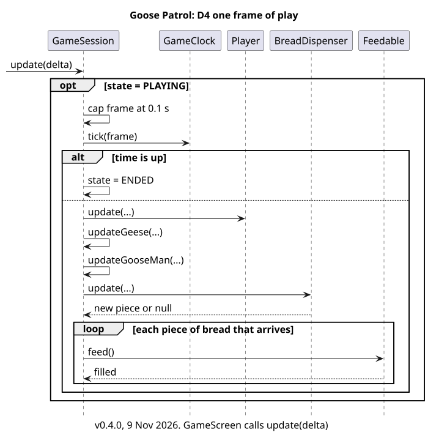](diagrams/v0.4.0/out/d4-frame-sequence.svg)

### D5 using an item

[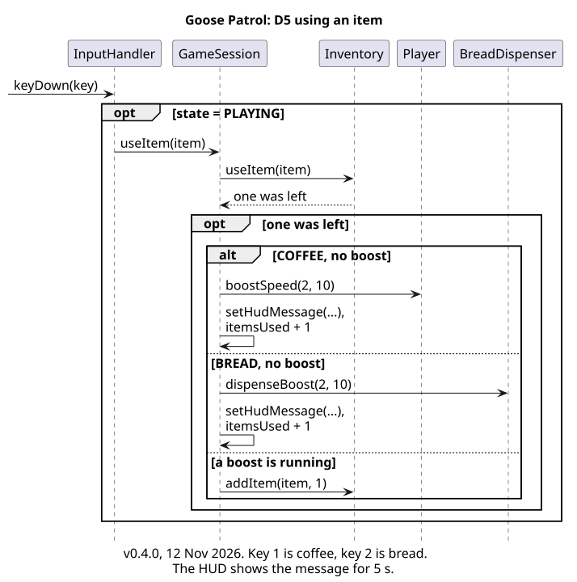](diagrams/v0.4.0/out/d5-use-item-sequence.svg)

### v0.2.0 diagrams (17 October 2026)

**D1 package overview**

[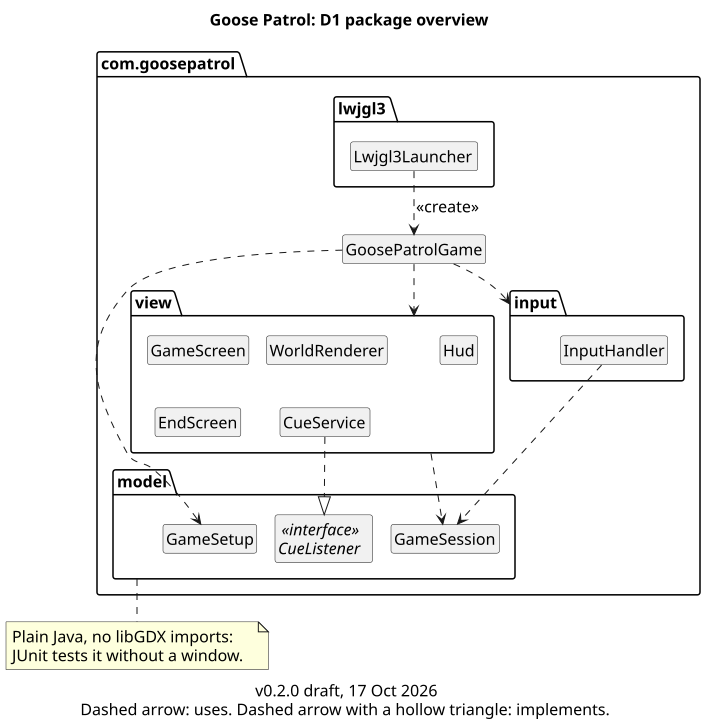](diagrams/v0.2.0/out/d1-package-overview.svg)

**D2 model classes**

[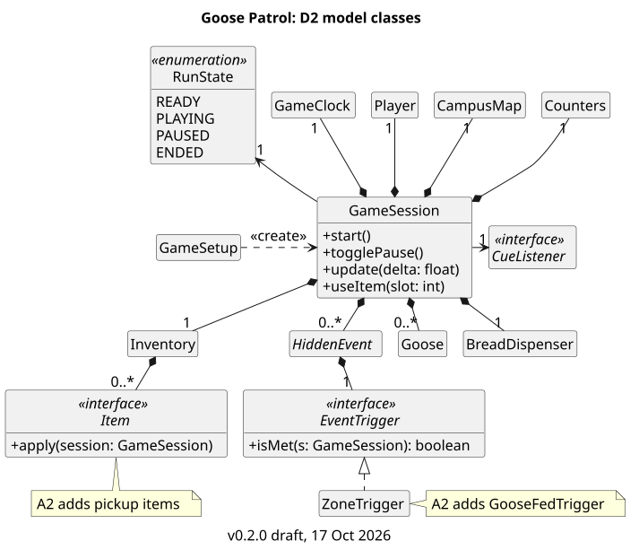](diagrams/v0.2.0/out/d2-model-classes.svg)

**D3 run states**

[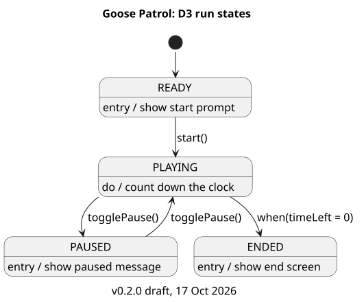](diagrams/v0.2.0/out/d3-run-states.svg)

**D4 one frame of play**

[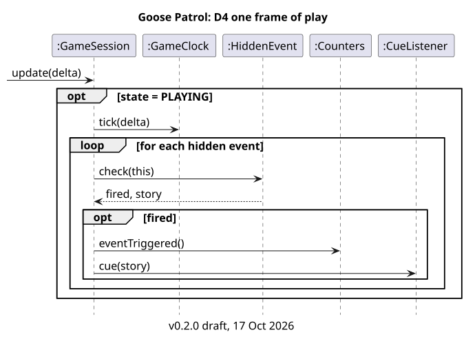](diagrams/v0.2.0/out/d4-frame-sequence.svg)

**D5 using an item**

[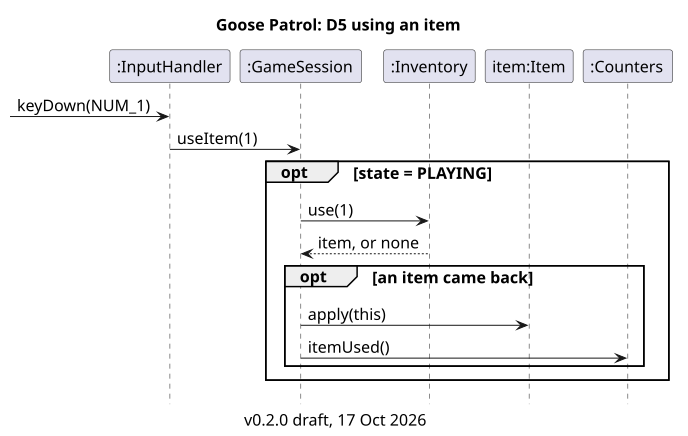](diagrams/v0.2.0/out/d5-use-item-sequence.svg)
